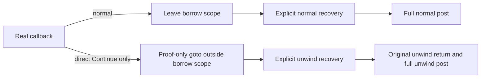

# Borrow recovery: normal control and direct-unwind boundary

Source audit: 6 October 2026, pinned VeriFast 26.09 source
`809de4596839b739dd999f9e462242c835e3af46`. This is an architecture note,
not a proof result or an implemented exceptional-routing feature.

The proposed automatic recovery lemma was rejected before execution. The
ordinary lifetime APIs `close_frac_borrow`, `end_lifetime`, and `borrow_end`
are `nonghost_callers_only` in `bin/rust/rust_belt/lifetime_logic.rsspec`
(76–79, 122–125, 280–283). `src/verify_expr.ml` (381–386) explicitly forbids
that attribute on auto-lemmas; its call checker (3136–3141) prevents an
unmarked lemma from calling these APIs. The mask-aware alternatives need an
`atomic_mask`, which real function bodies do not hold according to
`rust_belt/general.rsspec` (20–26). Neither marking the auto-lemma nor changing
the API family supplies a valid baseline proof.

The [normal-path control](verifast-borrow-recovery.md) instead calls an ordinary
`nonghost_callers_only` recovery lemma explicitly after a natural `let_lft`
block. Its input packages two initialization accesses, their close tokens and
both borrow-end tokens. After block exit returns the reserved half lifetime
token, the helper closes the accesses, merges fractions, ends the lifetime and
opens full borrow contents. Both `i32` and unrestricted generic `T` must return
full initialized cells and current `T.own`. No callback, unchanged-value claim,
readonly route, kernel cut or proof of std insertion is part of that control.

That normal mechanism passed on the unchanged release in run37437514808:
both positive callers and their actual generic helper verify, and the three
missing-resource/false-post controls fail for their intended reasons. See the
linked control note for exact source SHA, tool hashes, counts and timings.

Direct unwind is a separate obligation. The translator lowers
`UnwindAction::Continue` to `ReturnStmt(unwinding)` in
`vf_mir_translator.ml` (2475–2483). `BlockStmt.return_cont` returns the reserved
token and frees locals, but skips trailing ghost statements in `verifast.ml`
(2672–2680). The first comparison in actual `insert_tail` precedes the guard;
there is no Rust cleanup Drop edge on which to put explicit recovery. Full
normal/unwind storage posts remain required. Returning only comparison debt
does not complete the ledger's target contract.

## Candidate using existing AST control flow

An independent source review identified a conditional route worth evaluating
after the normal control. This would be a new translator-only semantic
experiment, not a baseline capability or an established soundness result.

`Cleanup` already lowers to `GotoStmt` (translator 2488–2492). The verifier
passes label environments through switch clauses (verifast 1147 onward) and
looks up outer labels for gotos (2690–2697). `BlockStmt.goto_cont` returns its
reserved token and frees locals before reaching an outer label (2672–2680).
Thus a proof-only exceptional label outside the borrow scope could execute a
source-written ordinary recovery call and then the original unwind return:

The source placement mechanism is unresolved. The pinned frontend reconstructs
blocks from MIR successors (`find_blocks`, translator 3640 onward), and fetches
ghost statements by source span before MIR statements (`fetch_ghost_stmts_before`,
1809 onward). A ghost statement written after the callback will not by itself
run on `Continue`. A candidate must use a precise source annotation and attach
its AST-only continuation after reconstruction, or construct a synthetic block
with explicitly audited successor bookkeeping. No existing supported annotation
for that exceptional continuation was established by this review.

Acceptance requirements before treating a candidate as evidence:

- Match an exact source-defined annotation, function and direct `Continue`
  edge; reject missing, duplicate, malformed and misplaced markers.
- Preserve the real callback, normal target and original unwind result.
  Preserve other Return, Cleanup, Abort and Terminate edges. In particular,
  never bypass the late comparator's actual guard Drop.
- End the borrow scope through existing verifier control flow before recovery;
  retain outer storage until recovery completes. Package reference identifiers
  and fractions in the debt predicate so inner ghost names need not escape.
- Prove the actual recovery helper at the same source version, require full
  normal and unwind storage/ownership posts, and retain dead-code/leak checks.
- Reject missing lifetime token, missing debt and false ownership/value posts
  for the intended reasons. Inspect real MIR and resulting AST separately to
  show that proof routing has not hidden a skipped Rust cleanup or destructor.
- Keep unchanged std source, pinned tool/prelude and independent refinement
  checks. Record the new translator trust boundary and its admissibility risk.

Even a passing direct-Continue control would not establish unrestricted
`FnMut(&T,&T)`, interior mutation, `ManuallyDrop<T>` guard-source provenance,
late Drop recovery, arbitrary-length insertion or Challenge 8 completion.
