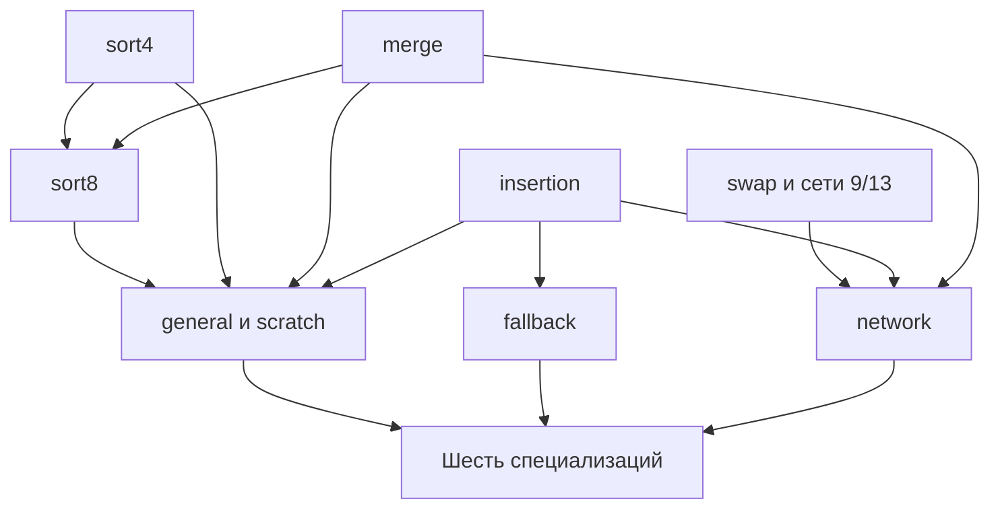

# План завершения Challenge 8

Challenge 8 завершён технически, когда семь целевых требований безопасности и три контракта сортировки проверяются на фактическом Rust std в полном заявленном домене, а доказательства callees применимы к их реальным callers. Главная оставшаяся работа — применимые в actual callers интерфейсы callback и ресурсов, доказательство циклов и композиция трёх алгоритмических путей: fallback, general и network.

План предназначен для Игоря и оркестратора: выбирать следующие двухчасовые задания и оценивать их вклад в конечный результат. Он фиксирует критерии завершения и зависимости, но не выдаёт новых разрешений на сборки, изменение инструментов или внешнюю подачу.

**База статусов — закрытые checkpoint 9 октября 2026 к 11:00 МСК.** Результаты работающих дневных сессий должны добавляться после их разбора; заранее им proof credit не присваивается. Полное завершение challenge пока не установлено.

## Принятая редакция приоритетов — 9 октября 2026

[Правила работы](WORK-POLICY.md) оформляют принятое решение по оптимизации.
Технические статусы ниже остаются датированным baseline; эта правка не выдаёт
новых proof результатов. Следующие задания выбираются после свежих checkpoint.

| Уровень | Критерий |
| --- | --- |
| Обязательное покрытие безопасности | R1–R7, допустимые длины и типы, legal comparator effects/panic, реальные callers и все требуемые UB checks |
| Основное функциональное покрытие | R1–R3: sortedness и сохранение вхождений; явно указать доказанные типы, порядок и premises |
| Отложенные усиления | Новые сложные stability proofs и универсальность функциональности по всем T/порядкам; сохранить готовые результаты |
| Обязательства метода | Ресурсный протокол, nonvacuity, source correspondence и qualification используемого профиля |

Разъяснение организатора о примитивных типах со стандартным порядком относится
к функциональной корректности ([issue #56](https://github.com/model-checking/verify-rust-std/issues/56#issuecomment-2611410906)).
Такое первое функциональное покрытие допустимо планировать без новых обобщений;
оно не заменяет generic safety и не гарантирует принятие всего Challenge 8.
Домены safety и sorting фиксируются отдельно для каждой цели.

## Конечные требования

[Условия Challenge 8](https://github.com/model-checking/verify-rust-std/blob/cd371e035c7e573760c43bf934d53e8118ee3e7d/doc/src/challenges/0008-smallsort.md) требуют безопасности семи целей и контрактов сортировки для трёх trait entrypoints. Проверки должны покрывать произвольные допустимые длины, SAFETY-условия исходников, dangling/misaligned accesses, uninitialized reads, immutable writes и invalid values. [Общие правила](https://github.com/model-checking/verify-rust-std/blob/cd371e035c7e573760c43bf934d53e8118ee3e7d/doc/src/general-rules.md) требуют автоматизированного решения в CI, допустимого интегрированного инструмента и сохранения runtime std.

Безопасность доказывается для произвольного допустимого поведения comparator, включая состояние и panic. Sortedness доказывается отдельно при согласованном отношении строгого слабого порядка и необходимых условиях сохранения ключей/элементов. Непаническое изменение счётчика в F само по себе не препятствует функциональному контракту.

В проекте нормальный функциональный результат означает отсортированность и точное сохранение исходных вхождений, а не только монотонность значений. Сохранение порядка эквивалентных вхождений (stability) — отдельное усиление: готовые доказательства сохраняются, но новые сложные stability proofs не входят в обязательный барьер завершения основного объёма. На unwind не обещаем sortedness или откат легальных эффектов callback. Полные resource/leak posts — обязательства выбранного доказательного протокола; отсутствие любой утечки не подменяет собой перечень UB из challenge.

## Матрица семи целей

В таблице «закрыто» означает полную целевую теорему с применимым профилем, а не отдельный зелёный запуск. Generic T/F в safety-строках не означает обязательную универсальность отдельной функциональной теоремы. Исторический результат сохраняет собственные source/tool identities и нуждается в проверке переноса на итоговую конфигурацию.

| Цель | Домен и необходимый результат | Свидетельства на базовом checkpoint | Критерий закрытия |
| --- | --- | --- | --- |
| R1 StableSmallSortTypeImpl::small_sort | Безопасность обеих специализаций; сортировка при функциональных предпосылках; scratch и все допустимые длины | Конечной теоремы нет | Проверены default insertion-путь и Freeze general-with-scratch; caller устанавливает все preconditions; sortedness + сохранение вхождений в заявленном функциональном домене и полный требуемый unwind; stability отдельно |
| R2 UnstableSmallSortTypeImpl::small_sort | Безопасность default и Freeze dispatch; сортировка во всём допустимом домене | Конечной теоремы нет | Проверены fallback и делегирование в R3, включая соответствие специализации и её контракту |
| R3 UnstableSmallSortFreezeTypeImpl::small_sort | Безопасность обеих специализаций и всех решений general/network/fallback; сортировка | Конечной теоремы нет | Все достижимые ветви, stack-size predicates, scratch и случаи раннего завершения покрыты; не требуется стабильность unstable network |
| R4 swap_if_less | Generic T/F, допустимые индексы и указатели; memory safety на normal/unwind | Исторический Kani для i32, позиций 1/2 в четырёх ячейках; 5 covers | Actual body проверено для полного домена; сравнение, ManuallyDrop, read/copy, alias и одинаковые индексы разобраны; функциональный compare-exchange контракт пригоден для networks |
| R5 insertion_sort_shift_left | Произвольные длины/offset, generic T/F; безопасность независимо от sorted-prefix premise | Историческая функциональность i32 для длин/offset 1..4; generic insert_tail незавершён | Actual insert_tail и внешний цикл доказаны инвариантами без исследовательского cutoff; полный диапазон восстанавливается на всех выходах; отдельно сортировка при отсортированном префиксе |
| R6 sort4_stable | Четыре элемента как полная арность; generic T/F, raw destination, допустимый alias/provenance domain | Concrete actual Kani: i32 multiset и tagged stability; pointer select R2 дошёл до недоказанного return post; полный generic sort4 открыт | Actual select/callback/four copies связаны; все пять panic exits закрыты; domain достаточного контракта согласован с требованием challenge и callers |
| R7 has_efficient_in_place_swap | Любой допустимый Sized T; нет pointer/comparator preconditions | Историческое isolated generic доказательство VF 26.09 на LP64, точный результат size_of(T)<=8 | Сохранена/проверена применимость к итоговому source/tool/target; lemma используется в реальном dispatch без подмены сложных size expressions |

Источник исторических границ — [coverage](https://github.com/Tiramisu-Cake/verify-rust-std/blob/20258b67c17d7e17ae25967488a98060969915a8/research/challenge-8/coverage.md). Для R6 текущий ночной checkpoint приоритетнее старых хронологических разделов coverage. R7 — полезный готовый исторический результат; его нельзя превращать в доказательство callers.

## Фактические пути исполнения

Три trait-метода дают **шесть тел реализаций** в текущем [smallsort.rs](https://github.com/Tiramisu-Cake/verify-rust-std/blob/20258b67c17d7e17ae25967488a98060969915a8/library/core/src/slice/sort/shared/smallsort.rs). Полное покрытие trait name без разбора специализаций недостаточно.

| Реализация | Вызов или выбор в actual source | Что должен установить dispatch |
| --- | --- | --- |
| Stable default для T | При len>=2 вызывает insertion_sort_shift_left(v,1); иначе возвращает | Корректный offset; общий контракт без Freeze; scratch не используется |
| Stable для T: FreezeMarker | small_sort_general_with_scratch | Scratch protocol и область входов этой ветви |
| Unstable default для T | small_sort_fallback | Полный контракт fallback |
| Unstable для T: FreezeMarker | UnstableSmallSortFreezeTypeImpl::small_sort | Применимость выбранной специализации R3 |
| Freeze default | General, если size_of(T)*48<=4096; иначе fallback | Определённость вычисления и корректность выделенного stack scratch |
| Freeze плюс CopyMarker | Network, если size_of(T)<=8 и size_of(T)*32<=4096; иначе general при size_of(T)*48<=4096; иначе fallback | Обе проверки, полнота выбора и соответствующий контракт; CopyMarker — не лицензия добавить Copy-предпосылку ко всем generic helpers |

Порог fallback равен 16, general/network — 32; scratch general — 48 элементов, network — 32. Пороги и их связь с допустимостью вызова необходимо доказать по реальным call sites. Они не дают права произвольно ограничить harness до удобной длины.

Связь алгоритмических компонентов, стрелка означает «используется для доказательства»:

Общие callback/ownership/provenance/Drop правила нужны нескольким узлам и не показаны отдельными рёбрами. Это карта зависимостей, не свидетельство готовности.

**sort8 — обязательный соединительный этап.** При size_of(T)<=16 и len>=16 general-with-scratch запускает две sort8; каждая состоит из двух sort4 и merge длины 8. При len>=8 вне предыдущей ветви вызываются две sort4; для меньших длин сначала копируется по одному элементу. Затем обе половины достраиваются через insert_tail.

Network при len<18 сортирует один region и возвращает; при len>=18 сортирует две половины, выполняет merge в stack scratch и копирует результат обратно. Regions используют sort13 при длине>=13, иначе sort9 при длине>=9, иначе стартовый prefix длины 1; затем insertion. Оба участка network обязательны.

## Область применимости до объединения доказательств

Первый контроль плана — полная карта допустимых входов и целевой платформы. Она нужна до объявления любой полной цели закрытой и до крупных новых вложений в узкий контракт. Исторический LP64 результат не переносится на другие ABI автоматически; финальный target и его layout assumptions должны быть явно указаны.

| Вопрос | Обязательство | Ошибочный короткий путь |
| --- | --- | --- |
| Произвольная длина | Для каждого entrypoint разделить normal, unwind и abort; доказать допустимый домен по исходнику и callers | Считать len<=32 общей предпосылкой всех целей только из названия SmallSort |
| ZST | Отдельно доказать logical occurrences, alignment, validity, pointer equality и фактический control flow | Удалить ZST, потому что верхнеуровневые stable/unstable sort имеют ранний ZST return |
| Bounds и арифметика | Разобрать len+16, size*32/48, len/2, one-past endpoints, wrapping и ordinary offsets во всём заявленном домене | Из проверки R7 size<=8 вывести корректность всех остальных арифметических ветвей |
| Abort | Учесть actual abort при invalid offset/недостаточном scratch/слишком длинном network input; доказать отсутствие UB до него | Доказать ens на недостижимом normal выходе и назвать функцию сортирующей |
| Sort4 overlap | Сопоставить adopted Separated4/raw-scratch контракт, короткий SAFETY comment и требования challenge | Назвать доказанный достаточный исследовательский контракт минимальным или автоматически принятым |
| Comparator effects | Вывести доступный frame из реальных borrow/provenance ресурсов caller | Считать FnMut запретом на captured raw aliases или гарантией чистоты |

У верхнеуровневых sort действительно есть ZST return: [stable](https://github.com/Tiramisu-Cake/verify-rust-std/blob/20258b67c17d7e17ae25967488a98060969915a8/library/core/src/slice/sort/stable/mod.rs), [unstable](https://github.com/Tiramisu-Cake/verify-rust-std/blob/20258b67c17d7e17ae25967488a98060969915a8/library/core/src/slice/sort/unstable/mod.rs). Это факт caller, не доказательство standalone целей R4–R6 и не полная цепочка применимости внутренних trait entrypoints.

[Принятый в исследовании контракт sort4](https://github.com/Tiramisu-Cake/verify-rust-std/blob/20258b67c17d7e17ae25967488a98060969915a8/research/challenge-8/SORT4-CONTRACT.md) намеренно достаточный и более сильный, чем краткая формулировка read/write-validity. Он остаётся рабочим контрактом. Для итоговой подачи нужно либо обосновать его полный требуемый домен, либо явно разрешить вопрос приемлемости с рецензентами. Внешнее обращение сейчас не отправляется. Если анализ обнаружит настоящий counterexample в требуемом домене, ветвь плана меняется на воспроизводимый дефект/уточнение условия; runtime нельзя молча исправлять внутри proof.

## Общие интерфейсы доказательств

Каждая композиция должна иметь проверенный переход «post callee плюс frame в pre следующего шага». Совпадение названий predicates или source hash само по себе такого перехода не даёт.

| Интерфейс | Что приходит | Что обязано вернуться |
| --- | --- | --- |
| Callback | Валидные shared аргументы, текущий F, точный legal effect/frame domain | Текущие T/F ресурсы на normal и unwind; завершённые временные borrows; без отката разрешённых эффектов |
| Pointer select | Значения указателей с исходной provenance; ownership самого pointer value | Точный выбранный вход, сохранённая provenance и frame; никаких новых прав на pointee |
| Raw copy и scratch | Валидный читаемый source, writable destination, определённая initialization/validity и overlap область | Соответствие скопированных representations и ресурсов; копия bytes не создаёт второй T.own |
| Guard и Drop | Непустой guard predicate, actual fields и законно переданный payload/resource pool | Actual method pre выводим; compiler drop glue доставляет effect caller; normal forget не теряет требуемые post-ресурсы |
| Loop и functional trace | Текущая индексная/ресурсная инварианта и реальные callback answers | Следующая инварианта, progress и boundary cases; functional trace связан с actual copies, а не отдельной моделью |

Для сортировки необходимо различать physical bytes, logical ownership, identity исходного вхождения и ключ сравнения. Padding может оставаться неинициализированным; byte-copy модель не должна превращать его в произвольный скалярный T или требовать лишнюю инициализацию.

При легальных изменениях через callback безопасность возвращает актуальное состояние. Равенство конечных элементов входному snapshot относится к более сильному функциональному контракту с соответствующими premises. Владение ресурсами, которые callback законно заменил или потребил, нельзя «восстановить» из старой записи.

Существующий протокол sort4 может оставить owners у source, а в scratch — representations без независимого права drop. Тогда возможность последующего generic сравнения/перемещения scratch нужно доказать отдельно. Альтернатива с переносом owners в scratch требует доказанного восстановления владельцев исходного v при последующей panic. Выбор интерфейса определяется callers; нельзя скрыто менять его между helpers.

## Три контекста применения merge

Одного proof merge с абстрактным destination недостаточно для всех его вызовов. Нужны три отдельных доказательства установления preconditions и обработки результата.

| Caller | Source и destination | Normal и unwind обязательства |
| --- | --- | --- |
| sort8_stable | После двух sort4 source находится во временном scratch; result идёт в dst | Обосновать доступ к scratch replicas. При panic partial dst не должен стать вторым владельцем; исходный v сохраняет требуемые актуальные ресурсы |
| small_sort_general_with_scratch | Две достроенные половины scratch → исходный v | До merge создаётся CopyOnDrop; normal возвращает единственных owners в v и забывает guard; unwind копирует текущий scratch назад с полным восстановлением |
| small_sort_network | Отсортированные половины v → локальный stack scratch, затем copy обратно | При panic merge исходный v сохраняет свой допустимый owning state, scratch не дропает replicas; после normal copy-back ровно один owning v |

**Отдельный участок до guard:** в general-with-scratch сортировка половин, sort8 и insert_tail выполняются до создания CopyOnDrop. Поздний guard не защищает эти callback/panic exits. Здесь нужно доказать протокол originals/replicas и допустимость scratch operations; guard-модель для финального merge этот участок не закрывает.

В network не применяется тот же rollback guard, что в general. В sort8 тоже нет собственного CopyOnDrop. Поэтому общая Drop-лемма полезна, но не заменяет три caller proofs.

Текущая [карта C1/F-frame](https://github.com/Tiramisu-Cake/verify-rust-std/blob/79464fb5e9e2278d4240cc388b7b778e9705ae5b/research/challenge-8/merge/overnight/CALLER-C1-FRAME-OBLIGATIONS.md) подробно описывает general-with-scratch; два других контекста нужно довести до сопоставимой точности. Это одна из первых задач интеграционного этапа.

## Рабочие пакеты и проверяемый выход

Статусы относятся к базовым ночным checkpoint. Предлагаемые владельцы — распределение следующих заданий после текущих сессий, не отправленные агентам инструкции.

| Пакет | Содержание и зависимости | Проверяемый выход |
| --- | --- | --- |
| W0 Область целей | Семь целей, шесть специализаций, valid lengths, ZST/abort, sort4 separation; оркестратор | Реестр доменов и coverage всех actual ветвей; спорные premises явно отделены |
| W1 Select и callback | R3 scope, selected-input relation, actual nested Drop, все пять sort4 callback exits; агент 1 | Полный actual pointer-select и применимый callback/resource interface; статусы общего профиля отдельны |
| W2 Guard и cleanup | Nonvacuous own/FBC, method pre, compiler glue, current values, forget; агент 2 с последующим переносом интерфейса | Проверенный callable CopyOnDrop protocol. Отдельная применимость count-n восстановления и one-cell gap |
| W3 Insertion и fallback | Достаточный для actual insert_tail callback/one-cell guard interface, ManuallyDrop/held-reference, loop invariants; полный W1/W2 не prerequisites | Actual insert_tail с normal/early-return/first-panic/late-panic; arbitrary-length R5; default Stable и Unstable fallback paths |
| W4 Sort4 и sort8 | W1, four-copy resources; для sort8 дополнительно проверенный merge длины 8 | R6 в заявленном полном домене и source-linked sort8 composition; контракт scratch пригоден caller |
| W5 Arbitrary merge | Исправленные OR controls/RESOURCE11, G2 12 координат, actual up/down, copies, resource loop, final panic | Arbitrary-n actual merge в полном нужном domain, без len2/3 cutoff; функциональная связь trace и памяти |
| W6 General callers | W2–W5; три режима presorted_len, scratch insertion и pre-guard panic | Полный general-with-scratch и stack wrapper; отдельный resource adapter его merge call site |
| W7 Swap и сети | W1 pointer-select, callback, read/copy/ManuallyDrop | R4 и exact-source sort9/sort13; связи compare-exchange и abstract sorting theorem проверены |
| W8 Network caller | W3, W5, W7; region/no_merge цикл, stack scratch/copy-back | Полный network для всех достижимых длиновых ветвей, panic и abort; без требования stability |
| W9 Dispatch и три sorting contracts | R7, W3/W6/W8, соответствие specialization | Все шесть implementation bodies; R1–R3 safety и sorting, valid-domain coverage |
| W10 Итоговый профиль и воспроизводимость | Поперёк всех пакетов, финальная сборка после W9 | Совместимые source/tool/spec identities, все обязательные UB checks, минимальный воспроизводимый proof suite и пакет для review |

W2 не считается закрытым от прямого PASS тела Drop: generated own=False и отсутствующая передача эффекта через generic glue остаются caller-блокерами. W5 не считается закрытым от G2 и чистой transposition-леммы: destination bytes ещё нужно получить из actual copy.

W3 опирается на [ресурсный ledger insert_tail](https://github.com/Tiramisu-Cake/verify-rust-std/blob/20258b67c17d7e17ae25967488a98060969915a8/research/challenge-8/INSERTION-RESOURCE-LEDGER.md). У one-cell gap другая область жизни tmp/held_ref, чем у count-n scratch guard. Перенос требует адаптера и проверки normal и cleanup edges.

Самостоятельный n13 specialization wrapper с индексами 0…12 отложен до actual Rust-интеграции W7: нужный интерфейс определяет caller. Готовая общая теорема сети сохраняется.

Для W7 возможна абстрактная теорема sorting network или доказанный zero-one принцип с проверенной связью actual schedule и comparator. Перебор отдельной булевой модели без этого мостика не закрывает generic Rust код.

## Порядок достижения конечного результата

План не требует сначала закончить все helpers, а затем впервые попробовать caller. Композицию проверяем рано, чтобы обнаружить несовместимые контракты до расширения матриц.

1. **Текущее окно.** Следовать последнему разрешённому заданию и свежему checkpoint своей ветки. Новые правила применять на безопасной границе шага, не отменяя полезную сборку и не меняя её pinned inputs. Старые названия R3/OR controls в исходной редакции не назначают их повторно.

2. **После checkpoint.** Сопоставить новые результаты с W1/W2/W5 и пригодностью к W3. Выбрать одно actual обязательство на агента, конкретный caller и источник его premises. Уточнять нужную часть W0 и resource interfaces; не добавлять семантические правила только ради зелёного fixture.

3. **Первая сквозная ветвь.** Ближайший ориентир — actual insert_tail → arbitrary-length insertion → default/fallback implementations. Проверить достаточный callback/one-cell guard interface на caller до расширения общих матриц. Pointer-select и полное закрытие count-n merge guard не являются prerequisites; перенос интерфейса требует собственного доказательства. Это даёт настоящие конечные пути R1/R2, хотя сами R1/R2 ещё требуют оптимизированных специализаций. Быстрота пути пока не установлена.

4. **Ранняя проверка scratch композиции.** Связать sort4 с sort8 и реальным caller. Для раннего sort8 допускается отдельное полное доказательство merge длины 8; оно не заменяет W5 arbitrary-n и не использует недоказанный summary.

5. **Закрытие general.** W5 и W6 объединяют sort8/sort4, insertion, guard и все pre-guard/merge panic exits. После этого закрывается Freeze-путь Stable и general-подмножество R3.

6. **Закрытие network.** W7/W8 добавляют compare-exchange, сети 9/13, insertion остатка и merge/copy-back. При готовом select это самостоятельная полезная ветвь; она не обязана ждать полного general.

7. **Полный dispatch и qualification.** W9 собирает шесть тел без сужения входов. W10 подтверждает совместимость профилей и финальную воспроизводимость. Вопросы admissibility изучаются с начала, а не откладываются целиком на этот этап.

8. **Подача и review.** Техническая готовность оформляется отдельным reviewable пакетом. Отправка upstream PR, внешних вопросов или tool application требует отдельного поручения пользователя. Решение комитета о принятии — последующий этап, а не синоним локального PASS.

Оценка сроков в днях пока не обоснована: число оставшихся semantic/model препятствий неизвестно. Календарь строим из закрывающихся obligations, а не из числа коммитов, controls или потраченных часов.

## Правила переноса и приёмки доказательств

У результата две независимые характеристики: **что доказано** и **насколько принят используемый профиль**.

| Статус результата | Что разрешено утверждать |
| --- | --- |
| Подготовлено | Есть кандидат и preflight; proof result отсутствует |
| Диагностика | Наблюдался конкретный stage/отказ/поведение, но целевой theorem не установлен |
| Компонент | Полный заявленный контракт отдельного тела/леммы в точном домене |
| Условная actual теорема | Полное actual тело и posts проверены, но domain/profile/trusted premises не закрывают конечное требование |
| Цель квалифицирована | Все части целевого домена и требуемые свойства закрыты, source applicability и профиль обоснованы для подачи |

Профиль отдельно отмечается как stock, экспериментальный, прошедший внутренние gates или принятый в upstream-интеграции. Эти статусы не взаимозаменяемы. VeriFast и Kani есть в [списке интегрированных инструментов](https://github.com/model-checking/verify-rust-std/blob/cd371e035c7e573760c43bf934d53e8118ee3e7d/doc/src/tools.md), но это само по себе не квалифицирует наши изменения kernel/frontend/specs.

Карточка каждого переносимого результата должна связывать:

- фактическую std функцию и source/blob identity;

- proof и infra commits;

- tool/compiler/spec/patch identities;

- target architecture и domain: T, длины, ZST, aliases, callback effects;

- normal/unwind/abort statements и функциональные предпосылки;

- проверенные actual callees и source correspondence;

- evidence Build ID, gates и первую незакрытую предпосылку.

Если разные части доказаны разными инструментами, нужен явный общий смысл их predicates и проверенная применимость premises. Concrete Kani theorem не становится universal VF premise; pure G2 не становится memory theorem. RAPx NO-GO по проверенному ZST detector остаётся ограничением исторической ветви, не источником дополнительных прав.

Различать новую верификацию, повторную классификацию сохранённых логов и ранее не выполненные cases. Replay исправленным auditor сохраняет исходный Build и hashes, получает отдельный результат и не даёт proof credit пропущенным cases или новой версии source/profile. Малые изолированные tests классификаторов разрешены локально по WORK-POLICY; proof toolchain остаётся в Cloud.

Проверки не следует без причины повторять целиком. Повторяем затронутые source/profile gates и интеграционную проверку, достаточную для конкретного переноса. Семантические изменения требуют обоснования и содержательных controls; никакое число controls само по себе не доказывает soundness.

## Контроль четырёх категорий UB

Итоговая таблица UB строится по actual operations каждой цели. Отсутствие соответствующей операции обосновывается, а не оформляется фиктивным положительным тестом.

| Категория | Что должно обеспечиваться автоматически | Текущий риск |
| --- | --- | --- |
| Dangling и misaligned access | Bounds/liveness/provenance/alignment у реальных reference formations, reads и writes, включая ZST | Чистая геометрия и отдельный layout fixture не закрывают typed operation |
| Uninitialized read | Initialization source и scratch на каждой реально читающей ветви; корректное отношение к padding | Инициализированные i32 buffers не покрывают MaybeUninit scratch |
| Immutable bytes mutation | Реальные write permissions и alias restrictions у всех stores/copies | В историческом измеренном Kani-профиле есть detector gap; нельзя выдавать его зелёный результат за всю категорию |
| Invalid value | Validity generic T, references и операций представления, включая частично инициализированный scratch | i32 почти не проверяет invalid representations; у исторического Kani validity instrumentation для copy отмечена неподдерживаемая операция |

Эти ограничения относятся к конкретным измеренным версиям/профилям из [coverage](https://github.com/Tiramisu-Cake/verify-rust-std/blob/20258b67c17d7e17ae25967488a98060969915a8/research/challenge-8/coverage.md). Выход — явное покрытие подходящим доказательным механизмом на actual source или обоснованная новая проверка профиля, а не отключение проблемной категории.

Unwind, leak/resource closure, dead-code/vacuity и source refinement дополнительно контролируют пригодность доказательства. Негатив засчитывается только на intended obligation; setup/refinement failure раньше этого места не даёт требуемого negative credit.

## Финальный критерий готовности

Challenge можно считать технически готовым к подаче только при выполнении всех пунктов:

- [ ] R1–R7 имеют полные safety statements и доказанное покрытие заявленных допустимых входов.

- [ ] R1–R3 имеют проверенные sorting contracts в явно заявленном функциональном домене; normal success не потерял/не продублировал элементы. Новые stability proofs и обобщения на все типы/порядки учитываются отдельно и не блокируют основной объём.

- [ ] Шесть специализаций и три алгоритмических пути покрыты; ранние return, abort и panic классифицированы.

- [ ] Actual callees и каждый caller-to-callee precondition установлены; нет неподтверждённых summaries.

- [ ] Циклы покрывают нужные произвольные длины; конечная арность sort4/network не подменяет generic type/resource coverage.

- [ ] ZST, non-Copy, non-Freeze там, где они допустимы, invalid representations, alignment/provenance и legal callback effects не исключены ради proof.

- [ ] Все четыре категории UB обеспечиваются автоматически для соответствующих actual operations.

- [ ] Normal/unwind resources, source/MIR/refinement и nonvacuity gates проходят; experimental trust debt разрешён или явно согласован для приёмки.

- [ ] Итоговый source/tool/spec/profile набор совместим и воспроизводим; исследовательские TEST lanes не включаются молча.

- [ ] Проверка запускается автоматически в пригодной для upstream review CI-интеграции; нынешний Cloud research workflow не принимается за уже выполненную upstream-интеграцию.

- [ ] Review пакет содержит contracts, domain rationale, source correspondence, trust ledger, команды и evidence index.

После этого статус — «готово к подаче», а не «принято комитетом» и не «вознаграждение получено».

## Обновление после каждой двухчасовой сессии

Оркестратор переносит результат в конкретную строку R/W и отвечает на четыре вопроса: какое обязательство закрыто; в каком домене/профиле; какой caller теперь может использовать результат; что осталось первым препятствием.

Следующее задание выбирается по сокращению разрыва до actual composition. Новый fixture полезен, когда проверяет конкретную предпосылку этой композиции. После повторных preparation failures отдельным результатом сессии может быть исправленная и проверенная подготовка, но она не повышает theorem coverage.

Режим работы остаётся согласованным: до двух часов, до 30 минут на завершение текущего шага, затем checkpoint и корректировка. План не продлевает окно и не добавляет Cloud-бюджет.

## Отдельная инфраструктурная задача

Фильтры нерелевантных automatic Flux/RAPx запусков, pinned toolchain image,
cache собранного VeriFast и короткая lane для служебных проверок вынесены
в WORK-POLICY, раздел 6. Это backlog с критериями проверки, а не уже внесённые
изменения и не дополнительная задача текущим proof-агентам. Кэш не заменяет proof
run; ускорение оценивается по измеренной стоимости и итерациям за два часа.

## Исходники и базовые свидетельства

Общий std baseline: upstream commit cd371e035c7e573760c43bf934d53e8118ee3e7d; SmallSort blob 40939f922bcb6fdc7ee0d30427fa861827043827 одинаков в обоих ночных checkpoint. Доказательства и профиль каждого результата всё равно имеют собственные pins.

| Свидетельство | Значение для плана |
| --- | --- |
| [Checkpoint select и sort4](https://github.com/Tiramisu-Cake/verify-rust-std/blob/20258b67c17d7e17ae25967488a98060969915a8/research/challenge-8/cloud-build/night-select-sort4/END-CHECKPOINT-2026-10-09.md) | R2 Build 218568df-ca79-43c5-a758-44764f1bac5c: return identity не доказана. R3 Build 03b0aa85-d825-4ccb-b5ec-b42939db7520: ghost-scope отказ до proof |
| [Checkpoint merge](https://github.com/Tiramisu-Cake/verify-rust-std/blob/79464fb5e9e2278d4240cc388b7b778e9705ae5b/research/challenge-8/merge/NIGHT-MERGE-CHECKPOINT-2026-10-09.md) | Build 9ad825fa-23f2-49f6-bc6c-db2052fe755c: actual len2/3 условный PASS на непринятом seven profile. Build ad653ca9-cab0-437d-a170-b15c3ad6ebbe: shape controls до matcher не дошли |
| [Actual SmallSort source](https://github.com/Tiramisu-Cake/verify-rust-std/blob/20258b67c17d7e17ae25967488a98060969915a8/library/core/src/slice/sort/shared/smallsort.rs) | Шесть специализаций; sort8; scratch и network callers; insertion и Drop; точный dispatch |
| [Исторический размерный helper](https://github.com/Tiramisu-Cake/verify-rust-std/blob/20258b67c17d7e17ae25967488a98060969915a8/research/challenge-8/verifast-swap-size.md) | Run 37401540878, proof 9fb8940437be22b316c45a3b23f9ece325944aae, VF 26.09/nightly 2026-02-05; isolated R7 |
| [Дорожная карта проекта](https://github.com/Tiramisu-Cake/verify-rust-std/blob/20258b67c17d7e17ae25967488a98060969915a8/research/challenge-8/PLAN.md) | Предыдущие этапы и исторические решения; текущая матрица дополняет её сквозной композицией |
| [Assessment композиции sort4](https://github.com/Tiramisu-Cake/verify-rust-std/blob/20258b67c17d7e17ae25967488a98060969915a8/research/challenge-8/SORT4-COMPOSITION-ASSESSMENT.md) | Различение чистой геометрии, функциональных лемм, actual memory proof и межинструментных мостов |

Подготовленные дневные кандидаты остаются кандидатами до свежих результатов. Идентификаторы source/proof/tool в evidence-карточках важнее хронологического положения заметки в STATUS или coverage.

