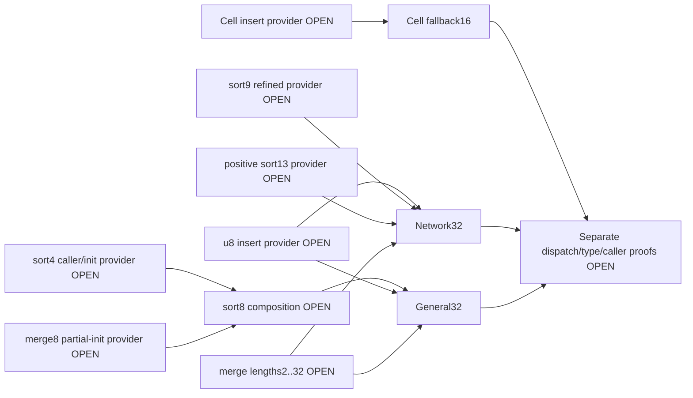

# S4 plan — length partitions first, proved summaries after applicability

**READY PLANONLY, bound to actual review and admission.** Authority is task
`40772cc748e9d2816c671d8aa46218abd62aba51` (Owner08:43 parallel offline work).
Intake `97eaff96cd28267e36af69fe98077dd08737eea6`; independent14
`135c04791a779e949079db723bdbc0e636873b37` APPROVE, zero findings, preserved limits;
separate root/coordinator admission `39606c431ba266a5dbab2163d0e5175428d38aec`
accepts **two exact QUALIFIED_BOUNDED_SOURCE_REPORTED cases**. Source
`f1bdf11902252ad1178f42403c253ae710fecbaf`, stock tool
`0aac16ef62da9e9d5645782d458593e5d78143ba` remain unchanged. PINS,
REVIEW-BINDING, ADMISSION-BINDING and DEPENDENCIES contain full identities/hashes.
No conditional packet was sealed; both actual decisions arrived before sealing.

Recommend a later, separately authorized **direct full-byte length-partition
campaign**, followed by provider work that addresses the actual caller paths.
Do not apply sort4/merge8/sort9 summaries to the two capped roots: none of those
functions occurs in Cell fallback0..16 or u8 network0..8. They become relevant
in general/sort8 and network9..32, after the missing contracts and applicability
proofs below. All summary edges in this plan remain OPEN; none is enabled.

The task input's S3-1 admission pin `7b4879b203e42e265f38ce1b44fe767aa78bb43fc`
has41 characters and does not resolve. Exact ACCEPTANCE.json history resolves
`b4879b203e42e265f38ce1b44fe767aa78bb43fc`; its committed bytes and source bindings
were read and pinned. INPUTS preserves the supplied value and resolution; no
input, admission, ledger or history was edited.

## What the bridge established

Both heavy families hit **whole-child600 WALL**, not RSS, after initial export
and native start. Compilation is inside600 and completed below180. Cell compile
upper bound37.293s / child600.515s / sampled PGID peak3007384KiB; network36.091s /
601.687s /3883252KiB. Effective cap6291456KiB in both cases. These sampled peaks
are not true kernel/cgroup/process-tree peaks. Exact symex/backend phase, VCCs,
uncensored native time and RSS at signal remain UNKNOWN. All17/9 length covers,
22/14 covers and four role sites per capped family remain unobserved, not proved.

Insertion51.863257375s and sort9223.202229754s are exported native
verification_time_s; their whole children are94.058/260.338s. Campaign1672.393379874s,
setup581.386216640s and tool-build283.670s are different scopes. No speedup or
fit estimate follows. EVIDENCE-FACTS projects the exact COST/QUALIFICATION reports;
no artifact acquisition, raw/log/member investigation or intake replay was repeated.

Admission39606 accepts insertion **u8/KeyLess, initialized V34/base1/p1/span2,
actual-body PFC**, and sort9 **u8/KeyLess, initialized V34/base1/len9, Original,
25 real swaps**. Each has four located SUCCESS roles and five SAT covers.
The11 positive U and7 SUCCESS unsupported guards remain explicit; all28 U across
completed rows remain reviewed source-local observations. Producer strict0/7,
REJECT_ALL/proposalDISABLED and workflow FAILURE remain historical facts.
No new location exception is needed/applied. Oldf740/ff193 cases do not transfer.
Admission supplies no universal summary, provider/init-mask/dstinit, Cell/type,
caller/ownership/panic/trait/MIR/B1/B2/fullN16N32 proof.

## Exact leaf and provider applicability

All current source citations use repo `/root/verify-rust-std-ch8-s3s4-bridge1-w13`
at full sourcef1bdf. SOURCE-CITATIONS records file/range hashes and coordinates;
LEAF-APPLICABILITY gives15 leaf records with exact target/provider, evidence-source
commit, T/F, allocation/init/offset/frame/mode/domain and missing proof. The old
production/provider/model bytes used here equal current bytes; byte equality
rebinds source only, never admission to a new run/type/caller.

|Starting case|Exact scope and assurance|Missing edge to an actual caller|
|---|---|---|
|sort4 separate, b487 admission|PFC u8/KeyLess; src6@1 to separate MU6@1; only dst canaries initialized|V34 to scratch48, offsets0/h/n and partially initialized surrounding scratch; destination init/locality and refined contract coverage|
|sort4 same-allocation, b487|PFC MU48, src/dst0..44 disjoint, all outside dst initialized|Does not cover an arbitrary partial-init scratch mask or arbitrary allocation merely because length4 matches|
|merge8 separate, b487|PFC src10@1 sorted4+4 to separate MU10@1 with canaries|No same-allocation scratch48, other lengths, odd centers, allocation reversal or generic init/provider proof|
|merge8 allinit, ff193|One PFC MU48/src32/dst0, initialized[8,48), sorted4+4|Only1/1122 prior geometry pairs. Actual first sort8 scratch has only[32,40) initialized, so the allinit premise does not hold|
|merge8 partial diagnostics, ff193|src32→0 with init[32,40); src40→16 with init[0,8)+[32,48); native SUCCESS/metadata admission|INIT_OPEN/nonproviders. Actual init-mask/dstinit and every caller context still need proof|
|new insertion,39606|One admitted PFC V34/base1/p1/span2|All successive p2+, other bases/backings/Cell and full target-contract coverage remain OPEN|
|new sort9,39606|One admitted Original V34/base1/len9, first9 full count/frame|No functional target contract/PFC provider exists. Need slice9..12 suffix frame, second-region bases and caller/precondition proof before verified stubbing|

Registered safety providers such as sort4_safety_u64 and merge_safety_u64_len*
are not u8 semantic providers. The registered but unqualified
s3_merge8_u8_same_alloc is not a universal merge summary. A bounded PFC harness
with its own assumptions does not establish the target contract for every
pre-state allowed by that contract. A future refined contract must be proved
for its complete declared scope and every caller must imply its premises;
anything outside stays OPEN. No disabled ensures, unchecked wrapper/summary,
assume-invariant, extra Copy/Freeze premise or hidden domain weakening is allowed.

Cell is a separate obstruction: sorting_model's Cell projection/post is active
and reads whole logical bytes via get(), but sorting_s2_span is active **only
for u8/KeyLess**. Current insert_tail's span-guarded semantic ensures are inactive
for Cell. A safety-only Cell PFC therefore supplies no Cell functional summary.
Required P_INSERT_CELL is an actual proved logical-value/frame route for p1..15,
with initialized reads, real held-value/gap/CopyOnDrop restoration, pure
KeyLess<Cell> and checked order/full-count composition. It is not u8 type analogy,
physical shadow-init bookkeeping or a generic callback/ownership/panic theorem.

## Concrete decomposition toward the full finite families

Let h=floor(n/2). V is the exact initialized34 backing at active base1; S is a
separate MU48 scratch for the first general fixture. Offsets below are elements.
CALLER-MATRIX has83 exact length rows and all34 internal sort8 merge contexts.

|Caller lengths|Actual source path and required obligations|
|---|---|
|Cell fallback0..1 /2..16|Return / insertion offset1, tails p1..n-1 (max15); Cell provider plus checked initialized sorted-prefix/count/frame induction|
|u8 network0..1 /2..8|Return / one region, offset1, tails p1..n-1. No sort4, sort9 or merge call|
|network9..12|Actual sort9 first9, suffix preserved, insert p9..n-1|
|network13..17|Actual positive sort13 first13, suffix preserved, insert p13..n-1; n17 needs p16/span17|
|network18..24 /25 /26..32|Two regions h,n-h: two sort9 / mixed9+13 / two sort13; then final merge n to separate MU32 and initialized copy-back|
|general2..7 /8..15|Copy1 / sort4 seeds at offsets0,h into S; copy each next input to S then insert p=seed..half_len-1; final merge n S→V|
|general16..32, u8 size<=16|sort8 twice: (V+1,S+0,S+n) and (V+1+h,S+h,S+n+8); insert p8..half_len-1; final merge n and guard obligations|
|general16..32, size>16|sort4 seed branch, not exercised by u8; concrete type/full-value model/provider work remains separate|

Each sort8 executes two sort4 calls into its temporary8, then merge8 back to its
destination. Over n16..32 the merge8 pairs are `(src=n,dst=0)` and
`(src=n+8,dst=h)`:34 contexts. At n32 these geometries match the two partial
fixtures, whose native SUCCESS did not qualify init providers. One allinit
32→0 result cannot replace those masks. Prove seed outputs initialize the
sorted halves, keep disjoint provenance and known-value frame, and establish
complete output initialization before any typed read or later merge/copy.
General's final merge reverses allocation roles relative to its seeds. Its
CopyOnDrop guard, normal success mem::forget and frame obligations remain.

DAG.json separates exact starting evidence from13 OPEN provider/caller nodes:
P_INSERT_U8, P_INSERT_CELL, P_SORT4_U8, P_MERGE8_U8, P_SORT9_U8, P_SORT13_U8,
P_MERGE_2_32, C_INSERT_LOOP, C_SORT8, C_FALLBACK16, C_NETWORK32, C_GENERAL32,
C_DISPATCH. Its24 edges identify every scope gap; enabled_summary_edges=[].

For insertion, prove each current tail initialized and sorted-prefix premises,
actual logical gap/held-temp transfer, precise write footprint, CopyOnDrop normal
restoration and order/count equivalence with the unchanged post. Bind these
checked invariants/lemmas to the real transformed body. No assumed loop invariant
or specification read from a hypothetical hole. Current p1 proves no later tail.
For final merge, cover every general n2..32 and network n18..32, both sorted
halves and odd-center behavior; n8 covers none of network's final merges.
Stable/unstable's six implementation/forwarding bodies, external minimum/larger
scratch versus stack48, NonCopyByte general, large types, ZST, arbitrary callbacks,
stability with distinguishable equal keys, ownership/panic and generic type/
allocation lifting remain separate. Source-only dispatch/PFC registration is not
compiler/MIR/ADT binding or independent B1/B2 credit.

## Small next campaign and exhaustive joining rule

NEXT-CAMPAIGN proposes **eight future selectors**, not a runnable request:
three unchanged fixed negatives (order/count/weak13), a new checker-only Cell
count-corrupt negative, and four actual-body Original positive blocks:

|Future positive ID|Exact retained domain|What it can establish if later admitted|
|---|---|---|
|s4p_fallback_b01_n00_02_fullbyte|Cell34/base1,n0..2, all34 logical bytes fullu8|Only these three lengths of the direct Cell helper|
|s4p_fallback_b01_n03_04_fullbyte|Same Cell domain,n3..4|Only these two lengths|
|s4p_network_b01_n00_02_fullbyte|u8 V34/base1,n0..2, fullu8|Only these three direct network lengths|
|s4p_network_b01_n03_04_fullbyte|Same u8 domain,n3..4|Only these two lengths|

The Cell checker negative uses initialized logical input[0,1] and corrupted
output[0,0]: order alone holds, full-value counts must fail at new literal
S4_NEG_CELL_COUNT, with active-model SUCCESS. It is a checker control, not an
actual-callee failure claim. Existing weak13 remains a fixed caller-copy control.
No eighth-root addition to the current seven-root profile is applied; a future
implementation must build and review its own exact profile/writer/readers.

Each positive retains four literal roles (active model, sorted/full count,
every outside value, arbitrary outside canary), all stock safety/arithmetic/
unwind checks, full initialized backing and normal-return scope. Demand a
separate native SATcover for **every selected length**, plus feasible n>=2
unsorted/duplicate/nonconstant, descending-at-block-maximum and useful return.
Never demand impossible unsorted/tie/nonconstant witnesses at n0/1. Unwind36 is
the existing source-envelope proposal for these direct roots; emitted exhaustion
checks must succeed. Provider/scratch roots need their own bounds derivation.

PARTITIONS defines exhaustive future length unions: fallback
`[0..2],[3..4],[5..8],[9..12],[13..16]`; network adds branch partitions
`[0..2],[3..4],[5..8],[9..12],[13..17],[18..24],[25],[26..32]`;
concrete u8 general `[0..1],[2..7],[8..15],[16..32]`. Within a censored block,
fresh fixed-N singleton IDs give a finer exhaustive split. No automatic repeat
of an unchanged600s root. Join only completed accepted cases with identical
source/tool/T/F/full-byte/backing/base/frame/normal-return premises and all
per-length SATcovers/roles. UNKNOWN/NOT_RUN/DIAGNOSTIC_ASSUMED never closes a
partition. Initial four positives join only0..4 for each family; fallback5..16,
network5..32 and all general remain OPEN. Even full unions are finite-domain
claims, not universal function contracts.

Distinguishing preflight controls must reject wrong Cell/u8 provider pairing,
p1 used for later tails, allinit provider used on partial scratch, missing length
covers, unproved sort9 suffix/base lifting, Original/PFC target swaps and stale/
missing/null/wrong-type identities/status/snapshots on local and upload replay.
All U/guards (including SUCCESS guards), exact negative labels, located roles,
full stock property partitions, cleanup, selected inventory and durable prefix
remain mandatory. New runs/IDs receive no inherited metadata/U/location waiver.

## Alternatives, cost and next decision

|Option|New information / potential symex change|Boundary|
|---|---|---|
|**Recommended direct length blocks**|Smaller n constraints bound insertion depth, model scans and branches; native covers identify completed lengths|CAP32 representation,34-element frame and instrumentation remain. No timing/fit claim; smaller blocks may still censor|
|Later proved compositional providers|Could replace repeated callee exploration after exact contract, coverage, init/frame and caller implications are proved|Addresses actual call DAG only. Original sort9 and bounded PFC cases do not authorize verified stubs|
|Optional assumed-summary diagnostic|Could isolate consumer cost under explicitly listed assumptions in a separate opt-in experiment|DIAGNOSTIC_ASSUMED, never qualified proof; remove assumptions only by proving actual refined providers and checked caller implication|
|Higher RSS / unchanged600 repeat|No support from these wall cutoffs for an RSS remedy; unchanged repeat adds little information|Not selected. No automatic escalation/rerun or inferred peak requirement|
|Longer child time|Would move a censoring boundary, not establish a provider or predictable fit|Not selected without new narrower-domain/phase evidence and explicit prospective review+GO; no cap edit here|

All defaults stay child600 includingcompile180/slot720/controller180+cleanup240,
campaign6900/outer7500/step7560/phase8100/setup1800/job180min, local6GiB sampledPGID,
outer12GiB owned census/reserve2available and Ceff=min(6,12,A-2). Outputs remain
16MiB/1MiB/8MiB/256MiB. Eight-slot envelope `8*720+180+240=6180<=6900` is arithmetic,
not actual fit or an execution grant. Accounting is TRACKING_ONLY; no obsolete
remaining-attempt arithmetic drives this design, and no ledger/reservation changes.

Root may select the compact direct experiment or a bounded provider-design task.
Either requires a separate explicit implementation assignment, exact candidate
review and coordinatorGO. This PLAN authorizes none of those stages. Native tools,
source/control/caps/policy/CI/push/accounting were not changed or run.
